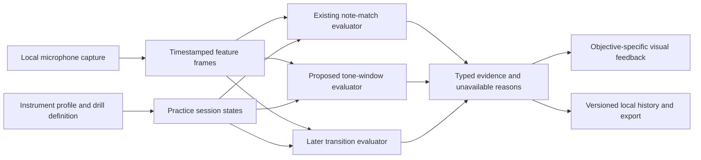

# Bansuri practice: proposal for discussion

2026-11-01, issue #19. Based on all 11 supplied Divine Bansuri transcripts, the previous PDF review and an audit of the released browser code. [Source knowledge and limitations](bansuri-foundations.md) · [task register](TASKS.md).

**Status:** research and proposed design only. No drills, diagram changes, audio evaluator, new scores or site deployment were implemented in this task. Owner requirement accepted during discussion: support both hand orientations, default left hand nearest the blowing hole. Remaining numerical settings below are experimental product parameters, not established teaching standards.

## Recommendation

Make **sound production** and **keeping the sound controlled while changing notes** visible, repeatable skill families. Keep pitch reflex as an optional workout once the player is comfortable with the relevant notes. A fast response and a clear sustained note are different skills.

Start with a small original three-drill pilot: **Find your tone → Keep your tone → Change one hole**. Show observable evidence, such as detected continuity, and keep listening-based clarity separate. Extend to all swars only after the core evaluator and fingering guidance work on actual bansuris. Do not begin by building an automatic “crystal clarity” percentage or a long chain of advanced lessons.

The first drill must work **before the learner knows their flute's key or can reliably produce middle Sa**. Tonic calibration belongs before named-swar comparison, not before discovering the first sound.

## Repeatable skill families and suggested introduction order

These are workouts, not chapters to finish forever. Introduction order expresses useful dependencies; it is neither a hard lock nor a claim that the teacher's playlist uses exactly this order. Experienced players can revisit any appropriate workout. Foundation tone work belongs in later sessions too.

| Order / family | Original workout idea | Main cue | Evidence and limit |
|---|---|---|---|
| 1 · Sound production | **Find your tone:** all finger holes open, small comfortable adjustments to lip/air/flute angle | Blowing-hole illustration and one short action | Sound/periodic-tone detection plus learner listening; no target pitch or automatic embouchure pass |
| 2 · Steadiness | **Keep your tone:** repeat one comfortable open-fingering tone in short windows | A horizontal ribbon that stays connected while tone is detected | Detected continuity and pitch variation; no claim of absent air noise |
| 3 · Hole control | **Change one hole:** open → close 1; later close 1 → 1–2 → 1–3, then reverse | Six-hole mask; only the changing hole is emphasized | Ordered sound changes and continuity; actual physical sealing remains unverified |
| Setup milestone | **Find my middle Sa:** use three-hole convention and confirm the sounding register/reference | Three-hole picture + Sa / Western pitch | Sustained detected candidate, then learner confirmation; never certifies the whole flute |
| 4 · Stable swars | **Keep each swar steady:** Sa, Re, Ga separately; later comfortable lower Ni/Dha/Pa and other swars | Swar/register + hole guidance + hold ribbon | Tuning, steadiness and detected gaps per swar; listen separately for unwanted hiss |
| 5a · Register control | **Choose the register:** lower/middle on a comfortable known fingering; discover first, then deliberate arrival | Low/high register cue and reference line | Arrival in intended octave and stable continuation, not air speed or correct body action |
| 5b · Partial-hole tuning | **Find Shuddha Ma:** approach, settle, repeat; later one komal swar at a time | Partial-hole symbol and explicit swar | Stable tuning against the stated reference; no exact percentage-opening instruction |
| 6 · Connections | **Keep the sound while changing:** Sa–Re, Re–Ga; then reviewed Tivra-Ma–Pa and Shuddha-Ma–Pa as separate drills | Current pair and changing holes | Arrival order, transition duration and detected interruption, with a deliberate transition allowance |
| 7 · Sargam | **Slow ascent / descent:** short groups before full Shuddha sargam | Sargam strip; register and altered-Ma distinction | Correct order, sustained arrivals, continuity; breaths between defined phrases are allowed |
| 8 · Patterns | **Pairs, triples and jumps:** start slowly, work both directions | A short original pattern | Sequence/transition evidence, not surprise recall speed; exact source patterns need separate transcription |
| 9 · Pulse | **Fit the beat:** one swar over several beats, then one per beat, then subdivisions | Visible pulse, optionally reviewed accompaniment | Onset/duration scoring only after latency and accompaniment contamination checks |
| 10 · Expression | **One gesture at a time:** tonguing, kan, meend, murki, andolan, vibrato, gamak, later combinations | Gesture-specific contour/demo | Guided/self/teacher practice first; dedicated contour evidence later, never ordinary hold penalties |
| Parallel · Recall | **Swar reflex:** random targets from the player's practiced pool | No upcoming target; current swar or sheet | Existing pitch-response estimate with the existing calibration limits; not a tone-quality assessment |

The course introduces some register work before naming swars and postpones Shuddha Ma until partial-hole instruction. Our introduction order deliberately separates those dependencies. Do not present full **Shuddha** sargam before explaining its Ma, and do not substitute Tivra Ma while keeping the same exercise name.

## The smallest useful first pilot

### A. Find your tone

Preparation shows an original illustration, comfortable support, all finger holes open, and one instruction: aim a gentle air stream across the blowing-hole edge and explore small adjustments. Link to the teacher's demonstration for lip position; captions alone are insufficient for a faithful animation. No mandatory Sa confirmation, tempo or speed score.

During discovery, show a simple live ribbon and labels such as **Sound heard**, **Tone detected**, or **Not enough signal to measure**. An audible unpitched air stream may have RMS without a reliable pitch. That is useful exploration, not a wrong note. If the learner gets no tone, offer one possible adjustment at a time, phrased as a possibility. Do not claim “your lips are wrong” or “hole 2 is leaking.”

Use a short optional observation window, initially around 2 seconds as a test parameter, with Stop/Rest available anytime. A learner can end an attempt early. Do not rank maximum breath length or encourage forcing more air. After a few comfortable tries, ask a separate listening reflection: unwanted air noise / broken tone / comfortable consistent tone / not sure. This is self-reported and cannot turn a microphone observation into a verified clarity pass.

### B. Keep your tone

Use one comfortable fingering and pitch. Observe the **whole** planned short window, not just its first successful fragment. Show a ribbon for detected pitched sound, distinguish uncertain signal from a clear detected break, and end in a rest state. Do not automatically advance the moment the first 0.35–1 second hold passes.

Initially compare pitch steadiness around the player's own median pitch; no named-swar correctness is required. Once middle Sa is confirmed, named-swar versions can add tuning against that declared reference. Tone detection must not lock onto an unstable first frame or silently change the reference to make every sample pass.

Retain planned duration, actual observed duration and complete/early-stop/interrupted state. An early stop is not a completed full-window result and must not improve comparable progress by keeping only a successful fragment. Rest is always available without a moral/effort penalty; invalid or incomplete measurements remain visible as such.

Example report copy, illustrative rather than measured: **1.6s longest detected run in a 2.0s window · 1 detected interruption · pitch variation 12 cents**. A separate listening observation can say **Airiness: not assessed automatically**. Show sample/measurement coverage and an explanation when the result is unavailable. These numbers describe observations; none is a “musical talent” score.

### C. Change one hole, keep the sound

Two versions serve different purposes:

1. **Discover the movement:** before tonic setup, show an explicit hole change and let the learner explore its sound. Do not pretend any detected change proves they used the intended hole.
2. **Check the arrival:** after tonic/register confirmation, observe an ordered pair such as Ga → Re with the matched diagram. Accept an intentional pitch movement between stable endpoint windows. A brief transition is neither an immediate wrong-note event nor proof of a successful meend.

The player should be able to connect two swars without silence being required to advance. Rests between pairs remain allowed. Score the endpoint pitches and report a detected interruption separately. Distinguish connecting two notes from rearticulating them; future tonguing practice must expect deliberate envelope interruptions rather than penalize them.

Introduce the first three holes before extending closure to holes 4–6. Review any register-changing pair or alternate fingering before adding it. Use a per-hole mask so the diagram can eventually show a vented Pa. The proposed beginner pilot does not need a complete raga, all ornaments or every register.

## Metric contract: useful numbers with honest names

Every metric needs an observation window, denominator, eligibility rule, analyzer version and unavailable reason. The intended practice/rest regions define what counts; pre-start quiet, planned breaths and user pauses must not become failures. Within an active tone window, unpitched/quiet intervals are retained rather than discarded to inflate a score. Browser analysis gaps are marked unavailable, not diagnosed as playing mistakes.

| Measure | Proposed definition | Interpretation / guardrail |
|---|---|---|
| Measurement coverage | Analyzable observed duration / active observation duration | Measures capture completeness. Do not bridge long stale frames. Separate from the amount of detected tone. |
| Detected-tone coverage | Duration with usable periodic-pitch evidence / analyzable active duration | Signal observability, not clarity. Include unpitched intervals in the denominator. Display low coverage beside any pitch summary. |
| Longest detected run | Longest consecutive usable tone interval, in seconds | Measures detected continuity, limited by the analysis interval and gate. State the observation length. A short window is not comparable to a long one. |
| Detected interruptions | Re-entry gaps exceeding a declared duration after a tone starts, within a requested continuous region | Experimental gap threshold; do not count planned rests or separate every noisy frame as a new failure. Cannot tell a breath leak from microphone/room effects. |
| Pitch steadiness | Median absolute deviation of usable steady-region pitch, in cents around its median | Separates fluctuation from tuning bias. Needs sufficient coverage/duration and a stable intended register. No pitch variation number for unusable data. |
| Tuning bias / within-band time | Median signed cents from the declared target; time within a declared band / analyzable steady-region time | Only for named targets. Show the engineering reference (initially A4=440 and declared equal-tempered intervals); do not call it universal Hindustani/raga tuning. Missing pitch is not silently removed from the time denominator. |
| Transition / register arrival | Stable expected endpoint after the requested change, with elapsed transition time and detected gaps | Later evaluator, not reaction-time or fingering proof. Needs bounded transition allowance and explicit endpoint/register logic. |
| Listening reflection | The learner's categorical impression of unwanted hiss/breaks/comfort | Mark self-reported and keep out of microphone performance rings and automatic correctness percentages. |

Do not add all these numbers to one small screen. For early tone drills, emphasize **longest detected run**, **detected interruptions**, and **pitch steadiness**, with capture/tone coverage readily visible as evidence context. For a first-sound discovery attempt, some or all may be unavailable without implying failure.

**Airiness/clarity research is a later track.** Harmonic-versus-noise measures, spectral flatness or harmonic energy ratios could become features to investigate, not finished scores. A tone has natural harmonic and noise content; phone direction, wind at the microphone, clipping, room noise and device processing can dominate them. Loudness or YIN confidence alone cannot identify excess airiness. First compare features with human-labeled recordings across players, notes/registers, flutes and devices; keep an abstention state. Do not train or choose thresholds on the same player's recordings used to claim success.

## Architecture: one app, several kinds of practice evidence

Keep the existing instrument registry and shared capture/persistence/navigation. Extend the evaluator by **practice objective**, rather than create a separate app for each instrument or add bansuri conditionals to every pitch event. The same sustained-tone primitive may eventually serve Western flute/vocals, with their own guidance and parameters; do not impose it on decaying piano notes.

Suggested boundaries, not implementation commitments:

- **Instrument profile:** stable `flute` history identity retained; six-hole Hindustani variant, confirmed tonic/register, tuning-reference metadata, reviewed fingering variants, supported range and `nearMouthHand` (`left` default / `right`). Hand choice changes illustrations only. Unknown or unsupported fingerings remain explicitly unsupported. Do not mirror pitch/register meanings.
- **Drill definition:** stable ID/version, trained skill, instructions/source provenance, prerequisite suggestions, target type (free tone / fixed swar / ordered pair), intended continuous/rest regions, duration limits and evaluator kind/version. Avoid a universal `midi` target for first-sound exploration.
- **Capture/features:** reuse typed buffers, supply real timestamps, level/clipping indicators, pitch/periodicity and capture-gap markers. Retain unpitched frames. Add spectral work only for drills that need it and only after feasibility measurements. Do not add an ML model/backend to get basic duration/continuity evidence.
- **Evaluators:** keep existing note-match/reflex behavior stable. Add a pure bounded tone-window accumulator and, later, a separate transition state machine. Never repurpose `NoteValidator`'s first-match latch as a tone score. The evaluator knows which changes/rests are intentional. Abort/visibility/device interruptions cannot manufacture a completed window.
- **Session states:** prepare → optional short cue → listen/explore → observe → stop/rest → review/retry. Connected notes transition inside an active region; they do not wait for release between every target. Discovery remains user-directed; a measurement error cannot trap the user.
- **Feedback:** existing check/cross and restrained green/rose wash remain meaningful for confirmed note outcomes. Tone exploration uses neutral continuous evidence, not a red full-screen pulse every time periodicity disappears. One outcome cue at a completed short attempt is enough. No rapid flashes or exclusive reliance on color.
- **History:** a discriminated record for tone windows, separate from existing per-note attempts, with `drillVersion`, `analyzerVersion`, `evaluatorVersion`, reference/profile summary, window durations/coverage, metric summaries, unavailable reasons and separately labeled self-reflection. Do not invent note-attempt correctness for an observation-only drill.

### Persistence and compatibility

Current `history.ts` validates every session in its array as a note-attempt record. Adding a different shape without a reader/migration would make existing load/import paths fail. Before writing tone records, define and test a versioned union and adapters for legacy sessions/backups, preserve old IDs, and retain an exportable copy until migration succeeds. Store metric/config versions so later thresholds do not silently rewrite historical meaning.

Continue local-first with bounded retention and export/import; no login or database is needed for this pilot. Save compact summaries, not raw PCM or an unbounded sample history. If a compact trajectory is needed for review, define a bounded sampling rate, duration/point cap and storage budget first. Audio recording/playback is a separate opt-in feature, not implicitly enabled by microphone permission. Clearing history must still target only app keys and retain explicit confirmation.

### Performance and capture reliability

The current rAF loop offers pitch updates about every 60ms or later. That can support coarse exploratory feedback; it cannot substantiate fine articulation or sub-frame gap measurements. A nominal cadence is not a guarantee. Use timestamp-weighted durations with a maximum valid inter-frame gap; split/abstain when capture stalls, and do not count overlap between waveform windows as extra duration.

Use one streaming pass with bounded state for sums, duration/run counts and quantile samples; reuse the existing pitch workspace. Throttle visual updates independently from feature analysis. At 20 feature rows/second and a 5-second cap, a 100-row typed scratch buffer is a reasonable experiment, not a required production setting. Benchmark capture gaps and main-thread cost on target phones before increasing analysis frequency, moving processing off the UI loop or adding spectra.

The existing request disables noise suppression, echo cancellation and automatic gain control. Inspect supported capabilities and current track settings instead of assuming the device honored those preferences. Store only useful coarse measurement context, avoiding raw device IDs/fingerprints. [W3C capture specification](https://www.w3.org/TR/mediacapture-streams/). If settings are unavailable, mark that uncertainty.

Tanpura/reference audio and metronome/tabla must not score as the learner. Start with no speaker accompaniment during measured tone windows. Reference playback, if added, needs explicit play/listen separation and room-tail handling; external accompaniment also affects measurement eligibility. No source-recognition classifier is proposed here.

## A visual gym without a misleading score

Use the existing skill-board concept, grouped by these families, before inventing another complex map. Within a skill card, separate **recent practice**, **measured result for this objective**, and **evidence coverage**. Tone continuity should not fill the existing first-try pitch-match ring; a self-reflection should not thicken a measured-performance connector. No activity-based mastery, fixed biological muscle/forgetting curve, or talent label.

In a tone attempt, use a compact horizontal ribbon: filled segments for detected tone, gaps for missing tone evidence, a distinct neutral pattern for unavailable capture, and a small pitch track around a reference line when eligible. Text/icons/legend explain the states. Reserve the main six-hole diagram for hole changes; emphasize only the moving hole and the target register. Both orientations use consistent mouth-end numbering.

In results, show the few objective-specific numbers, an annotated miniature trace and a single practical next suggestion. Use **Repeat**, **Try another suitable workout**, and **Skill board**; reaching a window end means the attempt ended, not that sound quality was mastered. Human clarity feedback remains visibly separate.

## Execution order and completion criteria

1. **Documentation and discussion (this task):** preserve all-source coverage, mindset, conflicts, current-code gaps, accepted orientation requirement and this proposal. Done when linked from task/agent memory and reviewed for factual/proposal boundaries.
2. **Instruction/profile review:** inspect the cited video demonstrations and review with a bansuri teacher; resolve grip/alternate-fingering/partial-hole guidance. Confirm how the two owner flutes behave. Build an original orientation illustration later. Do not publish a diagram inferred solely from “this finger” captions.
3. **Analysis feasibility:** gather consented clear/breathy/broken/quiet samples across notes/registers, room/mic positions and both flutes. Check actual capture gaps, clipping, pitch/octave errors and whether proposed continuity/steadiness observations correspond to listening. Recording collection is not performed by this task.
4. **One small implementation:** free-tone discovery and steady-tone windows first, with observation-only language, stop/rest/retry, capability checks, typed evidence and compatible local history. Meaningful tests cover interruptions, stale frames, gaps, no signal, pitch drift, octave flips and legacy import. Validate on actual phones before interpreting the metrics as reliable.
5. **One-hole connections:** add deliberate endpoint/transition handling and only reviewed masks. Test continuous playing without forcing release. Distinguish intended transition from wrong arrival and missing measurement.
6. **Expand the workout set:** stable named swars, register practice and Shuddha Ma before complete sargam; original alankars next. Keep the old IDs readable, define new versions, and do not convert old pitch evidence into tone evidence.
7. **Later independent research:** calibrated rhythm and safe accompaniment, then gesture-specific ornaments, then optional human-labeled clarity estimation. None is required to make first-sound practice useful.

## Validation and discussion still needed

- Build a small recording/test matrix: same held pitch with clear versus deliberately airy tone, stable pitch with a break, pitch drift without a break, wrong register, a connected pair, deliberate tonguing/vibrato, pure air, humming, room noise, clipped/too-quiet input and browser capture interruptions. Human labels should identify intended skill and perceived sound separately.
- Report false detected breaks/holds, unavailable time, pitch/register errors and agreement with listening; include uncertainty and results by device/note rather than a single pooled accuracy. Reserve different players/instruments for validation where possible. Humming may still be accepted as periodic pitch; that limitation remains explicit.
- Choose acceptable error/abstention targets with listening evidence before calling these metrics validated. Proposed 2-second windows, capture-gap rules and future tuning tolerances need trials, not a claim of universal standards.
- Owner answered orientation: **both, left-near-mouth default**. Remaining discussion concerns the presentation of self-listened clarity versus automatic observations, video/teacher review of physical guidance, and which practical flute/device samples to use first. These do not prevent the documentation being complete, and they do not authorize invented measurements or implementation beyond this proposal.

Recommended next discussion: review the three-drill pilot and the distinction between **pitch correct**, **detected steady/continuous**, and **sounds clear to a listener**. That distinction controls both the interface and what we can honestly score.
